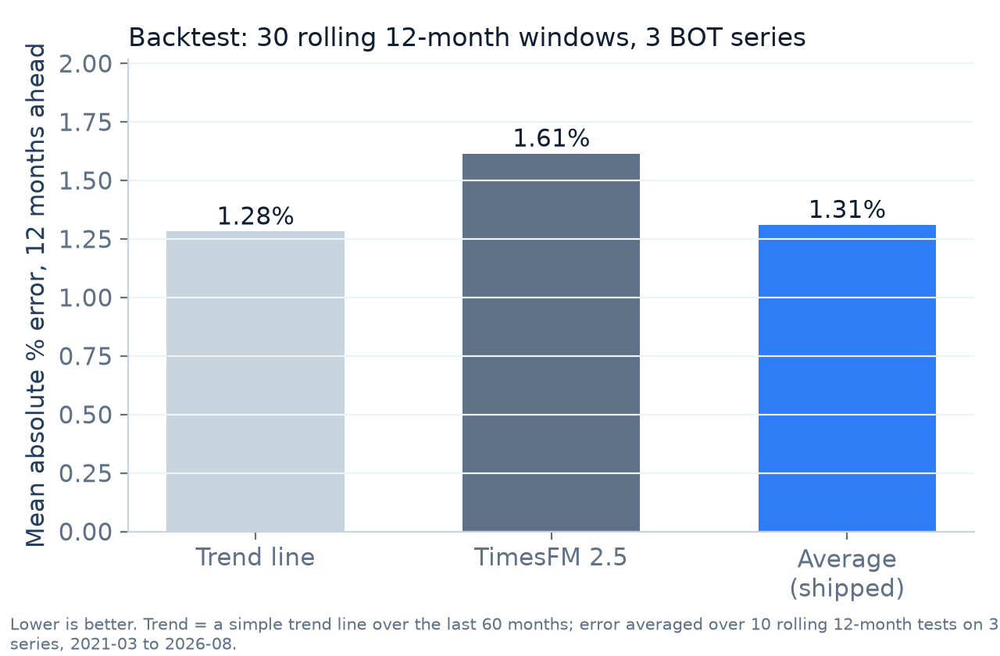
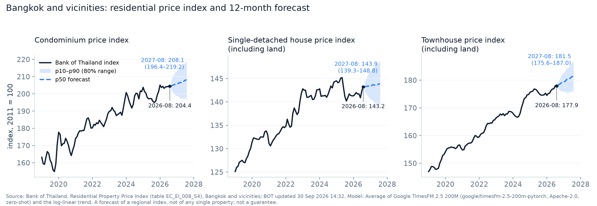

# MARKET ANALYTICS: model card (P2)

**Updated:** Fri 16 Oct 2026, ~05:50 ICT. Owner: P2 ([WORKPLAN.md](WORKPLAN.md) §5). Pipeline and commands: [pipeline/analytics/README.md](../pipeline/analytics/README.md).

Every number below was printed by the scripts in `pipeline/analytics/` and can be reproduced with them. The per-window results are in `pipeline/analytics/data/backtest.csv`.

## 1. Price forecast (`get_price_forecast`)

| | |
|---|---|
| **What it forecasts** | The Bank of Thailand **Residential Property Price Index** for **Bangkok and vicinities**, 12 months ahead, for three series: condominium; single-detached house (including land); townhouse (including land) |
| **Input data** | BOT table `EC_EI_008_S4`, base 2011 = 100, monthly, 2011-01 to 2026-08 (188 months per series), BOT update of 30 Sep 2026. Source note: `pipeline/analytics/data/SOURCE.md` |
| **Method shipped** | The **average** of two forecasts, quantile by quantile: **Google TimesFM 2.5 200M** (`google/timesfm-2.5-200m-pytorch`, Apache-2.0, zero-shot, CPU) and a **trend line**. The trend is the app's existing log-linear method: the slope of log(index) over the last 60 months, with a range from the spread of 12-month changes |
| **Output** | `src/data/market/forecast.json`: history + 12 monthly points with p10 / p50 / p90 (an 80% range) |
| **Why not TimesFM 3.0** | Its weights are under Google's *TimesFM Non-Commercial License v1.0* (non-commercial, non-production only). TimesFM 2.5 is Apache-2.0 |
| **Why the average** | In the backtest the trend line was the most accurate and TimesFM alone the least; their average was close to the trend. The team chose the average on 16 Oct (§2) |

## 2. Backtest

There were 10 rolling start points, every 6 months from 2021-02 to 2025-08, across 3 series: **30 windows**. Each method was fitted only on the months before its start point and scored on the next 12 months, so the scored periods run from 2021-03 to 2026-08.
- **Error** is the mean absolute percentage error (MAPE) of the central forecast (p50).
- **In range** is the share of actual months that fell inside the forecast's p10–p90 range. A well-calibrated 80% range covers about 80%.

| Series | Trend line error | TimesFM 2.5 error | Average (shipped) error | Trend line in range | TimesFM 2.5 in range | Average (shipped) in range |
|---|---|---|---|---|---|---|
| `condo_bkk` | 1.93% | 2.37% | 1.89% | 92.5% | 95.0% | 97.5% |
| `house_bkk` | 1.03% | 1.41% | 1.11% | 85.8% | 85.0% | 90.8% |
| `townhouse_bkk` | 0.89% | 1.07% | 0.93% | 100.0% | 90.0% | 96.7% |
| **All** | **1.28%** | **1.61%** | **1.31%** | **92.8%** | **90.0%** | **95.0%** |

TimesFM was more accurate than the trend in 12 of 30 windows; the average in 14 of 30.

**Reading it honestly:**
- On this index, the simple trend is as good as or better than the foundation model. That's likely because BOT publishes a **3-month moving average**, which is smooth and trend-dominated.
- The shipped average keeps TimesFM in the loop at near-trend accuracy.
- All three ranges cover **more** than 80%, so they are wider than they need to be (cautious).
- 30 windows from overlapping periods is a small test. Treat these differences as indicative.

## 3. Current forecast (from `forecast.json`)

Charts are drawn by `pipeline/analytics/chart.py` from `forecast.json` and `backtest.csv`; rerun it after a new forecast.

| Series | Last actual | 12 months later: p10 | p50 | p90 | Change (p10 / p50 / p90) | Last 12 months |
|---|---|---|---|---|---|---|
| Condominium price index (Bank of Thailand) | 2026-08: 204.4 | 2027-08: 196.4 | 208.1 | 219.2 | -3.9% / +1.8% / +7.2% | +4.5% |
| Single-detached house price index, including land (Bank of Thailand) | 2026-08: 143.2 | 2027-08: 139.3 | 143.9 | 148.8 | -2.7% / +0.5% / +3.9% | +2.1% |
| Townhouse price index, including land (Bank of Thailand) | 2026-08: 177.9 | 2027-08: 175.6 | 181.5 | 187.0 | -1.3% / +2.0% / +5.1% | +1.7% |

## 4. Real index in the price panel and the valuation (P2T07)

`src/data/index-sample.ts` (name kept for its importers) now serves the BOT series from `forecast.json` instead of SAMPLE values:
- The listing page chart and the index-adjusted estimate use the real BOT index, with the source shown and no SAMPLE banner.
- The valuation's **synthetic** training data was regenerated with the real index movement (`npm run valuation:dataset`), and the model was refitted (`npm run eval:valuation`). The rows are still synthetic and labelled; only their price-over-time path now follows BOT.
- Model card, as printed by `eval:valuation` on 16 Oct: median error 4.8% (unchanged), within ±10% **83%** (was 81.3%), range coverage **75%** (was 76.8%).

## 5. Market statistics (`get_market_stats`, `compare_to_market`)

| | |
|---|---|
| **What** | Per district × type × kind (sale/rent), plus all districts together: count, median / p25 / p75 **asking price per m²**, median price, median area |
| **Input** | P1's listings snapshot (`src/data/market/listings.json`). Thai portals blocked access and their terms forbid scraping (`pipeline/scraper/SOURCES.md`), so today's snapshot is **1,200 SYNTHETIC condo sales** from `data/valuation/demo_sales.csv`, labelled `is_sample: true`. Every stats answer says SAMPLE |
| **Method** | `describe.py` (pandas): medians and quartiles with linear interpolation. Groups with fewer than 5 listings are left out. The final `stats.json` is regenerated on the merged real snapshot (WORKPLAN M03) |
| **Trend** | The snapshot covers a few weeks, too short for a per-district trend. The tools show the **regional BOT index trend** for the property type instead, labelled as regional |

## 6. Limits: say these out loud

- **An index, not a property.** The forecast is for a regional price index built from mortgage-backed transactions. It is not the value of any single home.
- **Asking prices are not sale prices.** Market statistics come from listing websites on the snapshot date.
- **A range, not a promise.** Quote p10–p90 with the model name and the data source. Past movement doesn't guarantee future prices.
- **The data lags.** BOT publishes about a month after the period ends, as a 3-month moving average. The latest point is 2026-08.
- **Not advice.** This is general market information, not financial or investment advice.
