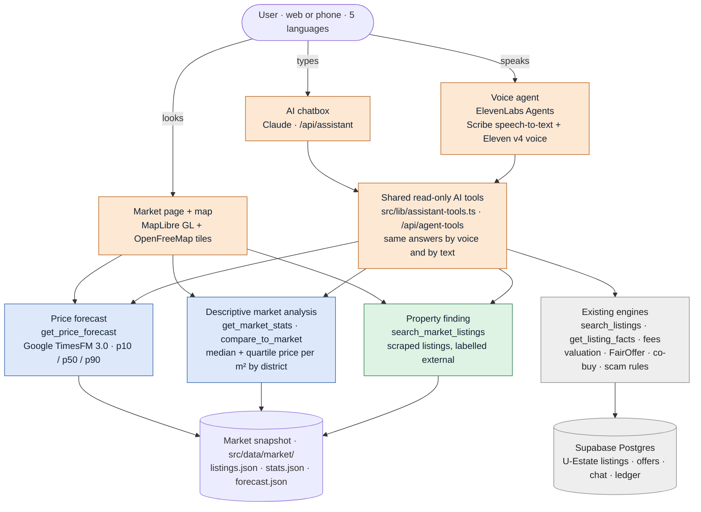
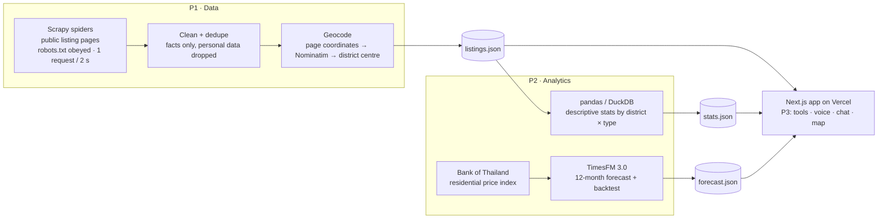

# TECH STACK: user → AI → engines → data

**Updated:** Fri 16 Oct 2026, ~05:00 ICT. Who builds what: [WORKPLAN.md](WORKPLAN.md). Rules: [DECISIONS.md](DECISIONS.md) (D-02 as amended, D-42).

The user talks to **two AI front doors**: a voice agent and a chatbox. A **market map** sits beside them. Behind them is **one shared, read-only tool layer**. The tools call engines that compute every number in code:
- **descriptive** market analysis: what asking prices look like now;
- a **predictive** forecast from Google TimesFM;
- property finding;
- the existing valuation, FairOffer, fees and co-buy rules.

The engines read data that an **offline pipeline** (Scrapy → pandas/DuckDB → TimesFM) prepares before deploy.

## 1. What the user touches, and what runs behind it

Colours show who builds each part: **P1** data (green), **P2** analytics (blue), **P3** experience (orange); grey already exists.

**One question, end to end:** *"Are condos in Sathorn getting more expensive?"*
1. The voice agent hears it and calls `get_market_stats {type: condo, district: Sathorn}` and `get_price_forecast {type: condo}`.
2. Code reads the snapshot and returns the median price per m², the quartiles, the listing count, the date and the source, plus the TimesFM 12-month range.
3. The agent says the numbers exactly as returned, with "asking prices from listing websites on 16 Oct" and "a forecast, not a guarantee". It then offers to open the map.

## 2. The offline pipeline (runs on a laptop before deploy, not on Vercel)

**Why offline:**
- TimesFM needs PyTorch and a ~330M-parameter checkpoint, so it can't run in a Vercel function.
- Scraping during judging would be slow, fragile and impolite to the source sites.
- The pipeline writes three small JSON snapshots into `src/data/market/`. They are validated against one contract (`src/lib/market-data/types.ts`) and committed. The app only reads them.
- The judge story: "a snapshot from 16 Oct; in production this runs nightly on licensed feeds".

## 3. The tools (free and open source wherever possible)

| Layer | Tool | Cost / licence | Used for |
|---|---|---|---|
| Voice | **ElevenLabs Agents** (Scribe STT, Eleven v4 Turbo TTS) | Partner credits | Live voice agent with client tools (existing E3) |
| Chat | **Claude API** (`claude-opus-5-5`) via the Anthropic SDK tool runner | Paid API | Typed chat over the same tools (existing) |
| Scraping | **Scrapy 2.19** | Free · BSD-3-Clause | Spiders for public listing pages (P1) |
| Cleaning + analysis | **pandas**, **DuckDB** | Free · BSD-3 / MIT | Clean, dedupe, medians and quartiles (P1, P2) |
| Forecast | **Google TimesFM 3.0** (`pip install "timesfm[torch]"` 3.0.2; checkpoint `google/timesfm-3.0-pytorch`) | Free · Apache-2.0 | Zero-shot price-index forecast with quantiles (P2) |
| Map | **MapLibre GL JS 6.14.0** | Free · BSD-3-Clause | Interactive map component (P3) |
| Map tiles | **OpenFreeMap** (`https://tiles.openfreemap.org/styles/liberty`) | Free, no key · OpenStreetMap data (ODbL) | Base map. **Keep the attribution visible** (P3) |
| Geocoding | **Nominatim** (OpenStreetMap) public API | Free · max 1 request/s, cache results | Project or district → coordinates (P1) |
| Official data | **Bank of Thailand** residential property price index | Free, public · cite source and date | Forecast input, and later the real index for the price panel (P2) |
| App | Next.js 16, React 19, Tailwind 4, zod 4, Supabase | Free · MIT / Apache-2.0 | Existing |

## 4. Data rules for scraping (D-02 as amended, demo only)

1. **Public pages only.** No login, paywall, CAPTCHA or anti-bot bypass. If a site blocks us, stop and pick another site.
2. **Check before crawling.** Read `robots.txt` and the site's terms, then record the result and date in `pipeline/scraper/SOURCES.md`. Scrapy runs with `ROBOTSTXT_OBEY = True`.
3. **Be polite:**
   - one request at a time per site;
   - `DOWNLOAD_DELAY ≥ 2` with AutoThrottle;
   - the HTTP cache on, so reruns don't hit the site again;
   - about 500 pages per site at most;
   - an honest User-Agent that names the project.
4. **Facts only:** price, size, type, district, rounded coordinates, bedrooms, listing date and source URL.
   - **Never stored:** descriptions, photos, agent or owner names, phone numbers, LINE IDs or emails (Thailand's PDPA).
   - The contract rejects extra fields, and a test scans for phone numbers, emails and LINE IDs.
5. **Raw HTML stays local** (git-ignored). Only the cleaned JSON is committed, because the repo becomes public at submission.
6. **Always labelled:**
   - Every scraped number is shown with its site, its date and "not checked by U-Estate", plus a link to the source.
   - Scraped listings are **never** shown as U-Estate listings, and they can't receive offers or co-buy.
7. **Production** uses licensed feeds, or partner data shared with consent (D-13).

## 5. Honesty labels the AI must keep

- **Asking prices are not sale prices.** Say "asking prices on listing websites".
- **Forecasts are not guarantees.** Give the p10–p90 range, the model name and the input series with its source.
- **Fixtures and SAMPLE data:** while a snapshot's `meta.is_sample` is true, every screen and every tool answer says SAMPLE.
- Code computes every number (D-32). The AI reads, explains and translates; it never invents a figure.
